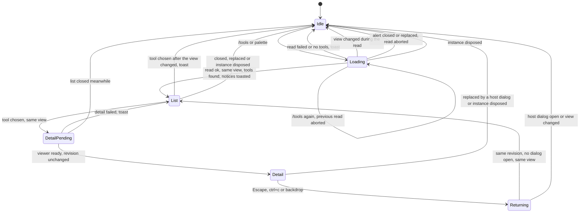
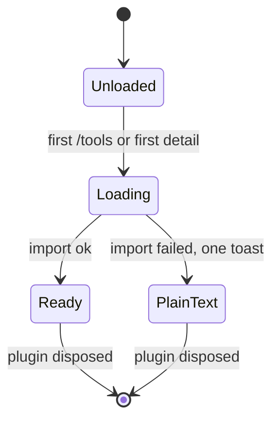
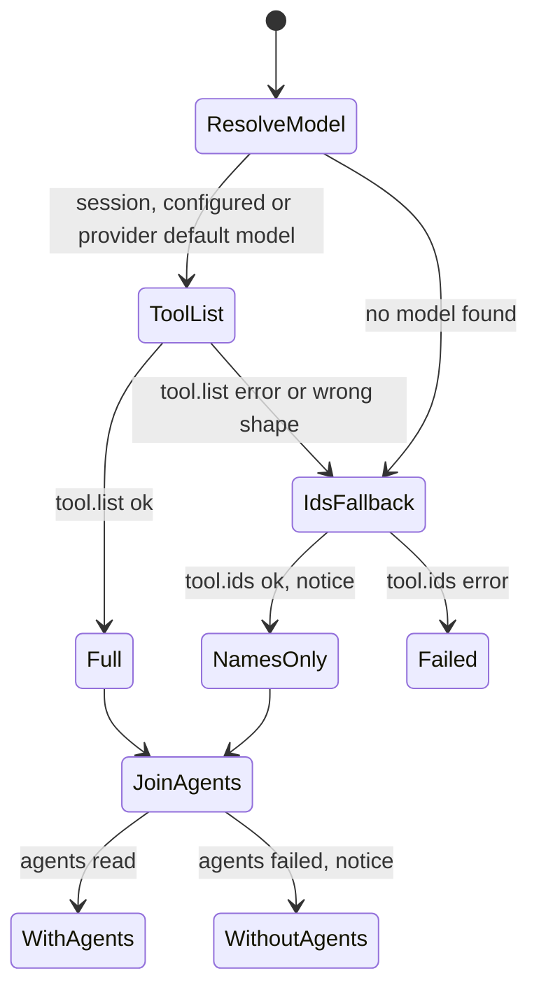
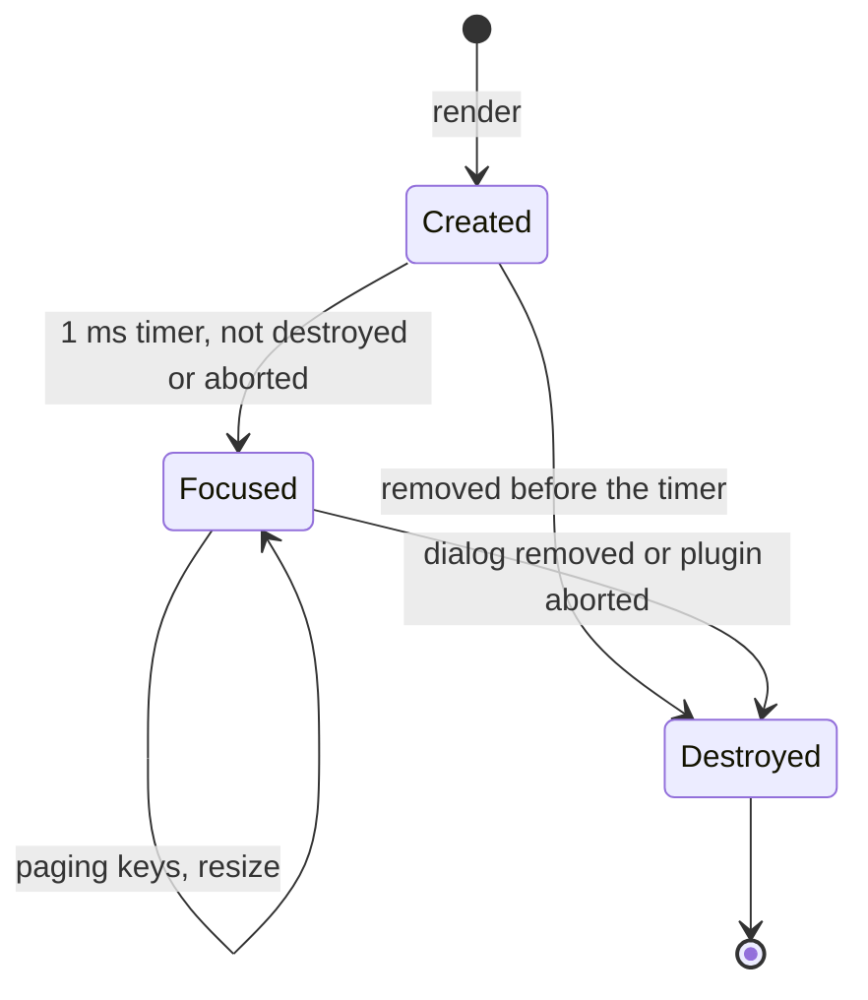

# State machines

This document describes the state Tool Inspector keeps across commands, dialogs and host events. Update it in the same PR as any change to these states, their triggers or their exits, following the [state machine conventions](https://github.com/lunchbox-labs/.github/blob/main/agent-guidance/state-machines.md). Known bugs belong in issues, not here.

The plugin keeps no kv-persisted state, no intervals and no retries. Its only timers are the detail view's focus timeout and the microtask that returns to the list.

## Browser dialog controller

`registerToolBrowser` in `src/tui.ts` keeps `revision`, `showing` and `activeRead`, changed by `close`, `display`, `open`, `views.list`, `views.detail` and the `server.instance.disposed` watcher. Every displayed dialog gets a revision, and stale host close callbacks and late reads compare against it and do nothing. Each step takes a `sameView` check from `viewContext`, which holds while the directory, route and session are unchanged and the plugin lifecycle is not aborted.

- `/tools` or the palette's "Browse tools" opens a "Loading tools" alert and starts a catalog read. Running it again aborts the previous read.
- A read that resolves for the current revision and view shows the tool list, with one toast for any notices first. A failed read or an empty catalog closes with a toast. A read for a changed view closes without one.
- Escape, ctrl+c, Enter on the alert, a backdrop click or a host dialog replacing the alert aborts the read, and its late result is dropped.
- Choosing a tool waits for the detail viewer and shows the detail for the same revision and view. If building or showing the detail throws, a toast names the tool and the list stays. Choosing after the view changed closes with a toast to run `/tools` again.
- Closing the detail queues a microtask that reopens the list on the same tool when the revision is unchanged, no host dialog is open and the view is the same; otherwise the browser stays closed.
- `server.instance.disposed` for this directory closes any plugin dialog.

## Detail viewer

`viewer` in `src/tui.ts` memoizes the promise from `createDetailViewer` in `src/detail-viewer.ts`, created by the first `/tools` or the first detail. If importing or setting up `@opentui/core` fails, one warning toast says details show as plain text. Both the scrollable viewer and the plain-text fallback last for the plugin's lifetime.

## Catalog read

Each `/tools` read in `src/tui.ts` collects `modelFailure`, `listFailure` and `agentsFailure` while `agentsRead` runs in parallel.

- `chooseModel` takes the model of the session's latest user message, then the configured `model` when its provider is connected or providers aren't loaded, then the default of the first connected provider, then none.
- The tool list comes from `tool.list` for that model. If it fails, returns the wrong shape or there is no model, it falls back to `tool.ids` with names only and a notice. If neither can be read, the read fails.
- `readAgents` and `accessByTool` add each tool's agent access. If they fail, the detail leaves out its Agents section and a notice says why.

Every degraded outcome carries a notice, which the controller toasts.

## Detail view instance

Each render from `createDetailViewer` creates a scroll view, waits 1 ms to focus it and activate its paging keymap layer, and refits on resize. When the host removes the dialog, or the plugin aborts, it is destroyed and clears its focus timer, resize listener, keymap layer and abort listener. A theme change renders a fresh instance and destroys the old one.

## Registration and minor state

- The plugin registers its keymap layer and a `server.instance.disposed` subscription, and removes both on `api.lifecycle.onDispose`. Dispose does not close an open dialog: the detail view destroys itself on abort, and a list left open answers Enter with the toast to run `/tools` again.
- `compiledWildcards` in `src/agents.ts` memoizes one regular expression per permission pattern for the process.
- The host owns the list's filter and cursor. Returning from a detail restores the cursor on the tool, but not the typed filter.
