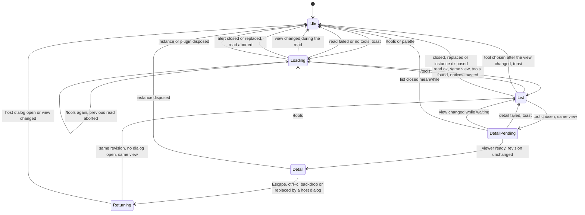
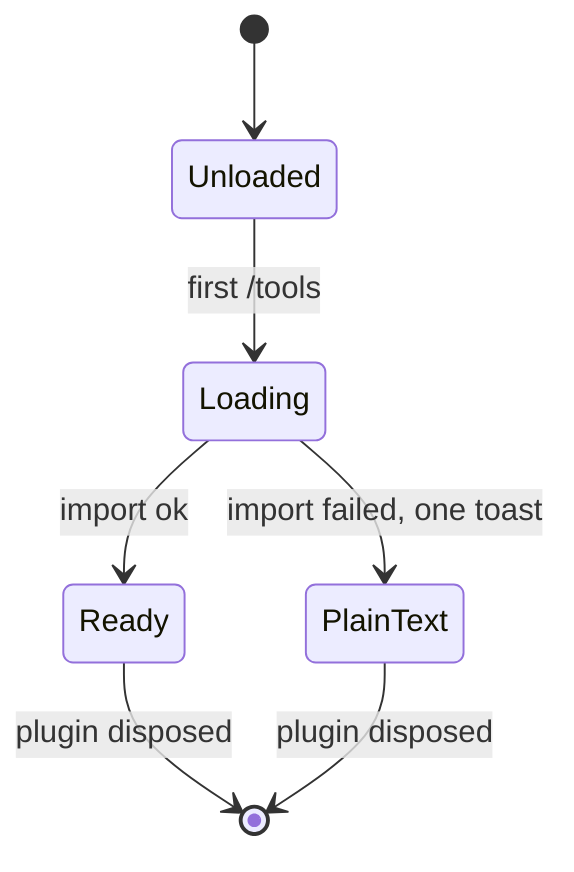
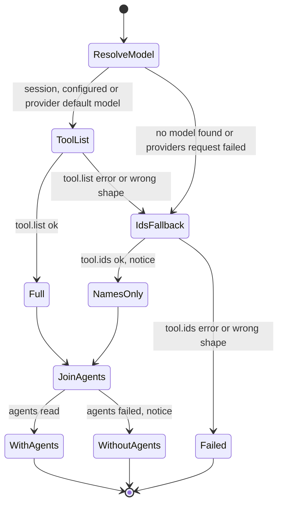
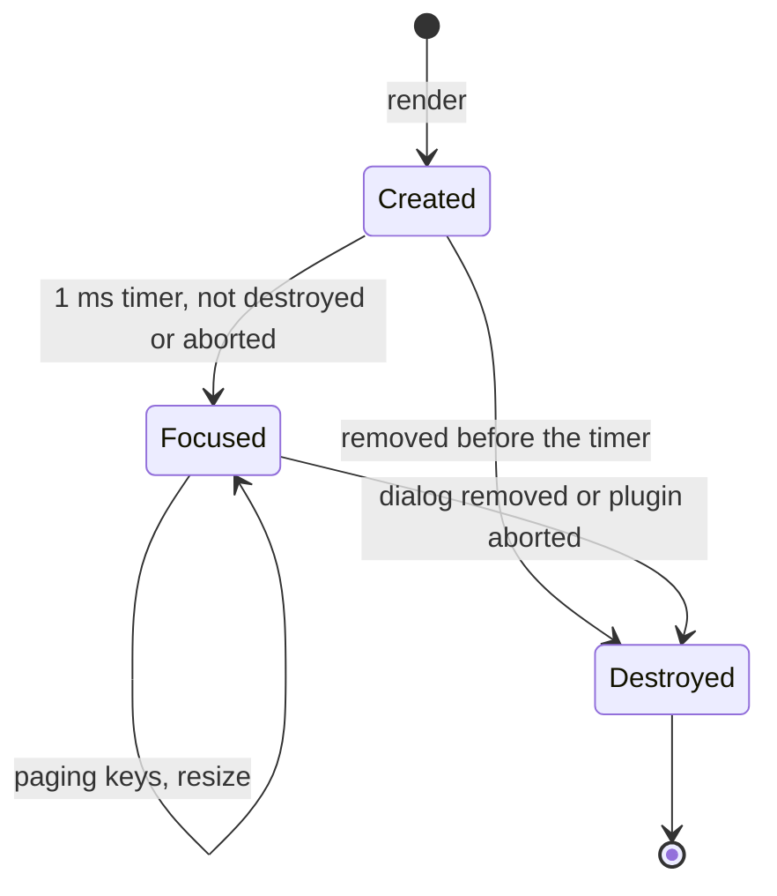
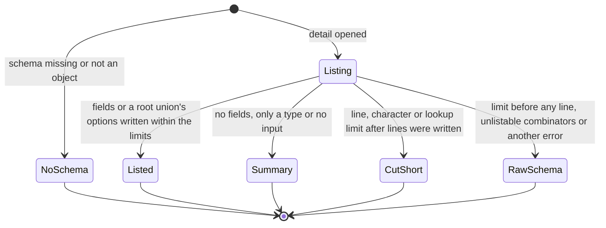
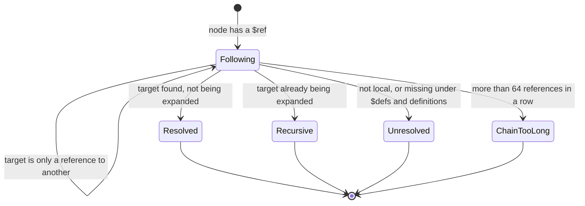
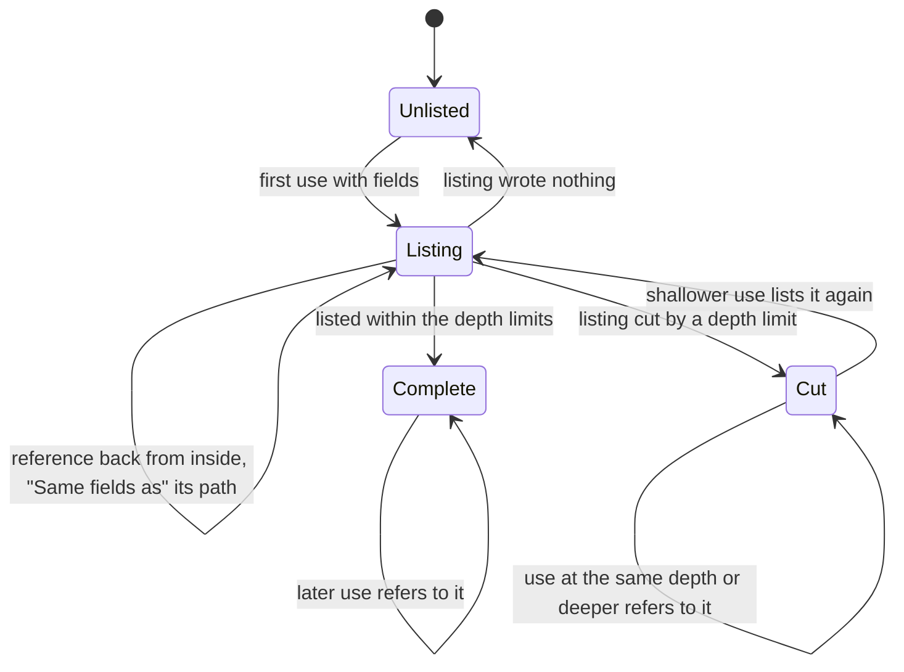

# State machines

This document describes the state Tool Inspector keeps across commands, dialogs and host events. Update it in the same PR as any change to these states, their triggers or their exits, following the [state machine conventions](https://github.com/lunchbox-labs/.github/blob/main/agent-guidance/state-machines.md), and cover each transition you add or change in `tests/`. Known bugs belong in issues, not here.

The plugin keeps no kv-persisted state, no intervals and no retries. Its only deferred work is the detail view's focus timeout and the microtask that returns to the list.

## Browser dialog controller

`registerToolBrowser` in `src/tui.ts` keeps `revision`, `showing` and `activeRead`, changed by `close`, `display`, `open`, `views.list`, `views.detail` and the `server.instance.disposed` watcher. Every displayed dialog gets a revision, and stale host close callbacks and late reads compare against it and do nothing. Each step takes a `sameView` check from `viewContext`, which holds while the directory, route and session are unchanged and the plugin lifecycle is not aborted.

- `/tools` or the palette's "Browse tools" opens a "Loading tools" alert and starts a catalog read, from any state. Running it during a read aborts the previous read.
- A read that resolves for the current revision and view shows the tool list, with one toast for any notices first. A failed read or an empty catalog closes with a toast. A read for a changed view closes without one.
- Escape, ctrl+c, Enter on the alert, a backdrop click or a host dialog replacing the alert calls its close callback, which aborts the read, and its late result is dropped. Plugin dispose also aborts the read, and the alert closes without a toast.
- Choosing a tool waits for the detail viewer and shows the detail for the same revision and view; if the view changed while it waited, nothing happens and the list stays. If building or showing the detail throws, a toast names the tool and the list stays. Choosing after the view changed closes with a toast to run `/tools` again.
- Closing the detail, including a host dialog replacing it, queues a microtask that reopens the list on the same tool when the revision is unchanged, no host dialog is open and the view is the same; otherwise the browser stays closed.
- `server.instance.disposed` for this directory closes any plugin dialog.

## Detail viewer

`viewer` in `src/tui.ts` memoizes the promise from `createDetailViewer` in `src/detail-viewer.ts`, started by the first `/tools`. If importing `@opentui/core` fails, one warning toast says details show as plain text. Both the scrollable viewer and the plain-text fallback last for the plugin's lifetime.

## Catalog read

Each `/tools` read in `src/tui.ts` collects `modelFailure`, `listFailure` and `agentsFailure` while `agentsRead` runs in parallel.

- `chooseModel` takes the model of the session's latest user message, then the configured `model` when its provider is connected or no provider is listed, then the default of the first connected provider that has one, then none. A failed providers request is kept as `modelFailure`.
- The tool list comes from `tool.list` for that model. If it fails, returns the wrong shape or there is no model, it falls back to `tool.ids` with names only and a notice. If `tool.ids` errors or returns the wrong shape too, the read fails.
- `readAgents` and `accessByTool` add each tool's agent access. If they fail, the detail leaves out its Agents section and a notice says why.

Every degraded outcome carries a notice, which the controller toasts.

## Detail view instance

Each render from `createDetailViewer` creates a scroll view, waits 1 ms to focus it and activate its paging keymap layer, and refits on resize. When the host removes the dialog, or the plugin aborts, it is destroyed and clears its focus timer, resize listener, keymap layer and abort listener.

## Schema rendering

`schemaLines` in `src/schema-text.ts` renders a tool's input schema each time its detail opens, synchronously, keeping a `Rendering` for that call: the lines written, the remaining character and reference-lookup budgets, how often a depth limit cut a listing short, the `allOf` merges that left members out, where each shared definition's fields were listed, and the first field that refers to each definition.

- A missing or non-object schema says OpenCode reported no input schema.
- Fields are written one line at a time. A line over 400 characters ends in "…", and enum, union, `type` and tuple element lists name their first few values and count the rest. Tuples read their elements from `prefixItems`, or an `items` list, and any further elements from `items` or `additionalItems`. Listings go 9 levels deep (depths 0 to 8) and write a "…" line below that, and array items, unions and `allOf` members are followed at most 64 levels, with "…" where `allOf` members were left out.
- Writing a 401st line, or going over 100,000 characters or 50,000 reference lookups, throws `SchemaTooLarge`. If lines were written they end with "… Schema too large to show in full."; otherwise the raw schema shows, cut to 400 lines with a count of the rest. Any other error, such as a stack overflow, also shows the raw schema.
- A root union lists each option's fields, under the same limits as any listing. A root with no fields to list shows `Input is <type>`, "Takes no input." or, for combinators that can't be listed, the raw schema.

### References

Each `$ref` resolves to one of four outcomes. A reference that misses under `#/$defs/` or `#/definitions/` is retried under the other, since OpenCode 1.19 renames zod's `$defs` without rewriting references, and references are keyed by the spelling that resolved. A definition that is only a reference to another is followed.

- **Resolved:** the target, with the reference's own keys over it, is rendered and the reference joins the set being expanded.
- **Recursive:** the target is already being expanded. Its type is the definition's name, or for a generated name such as zod's `__schema0`, its own type, else "same type as <field>" for the first field that refers to it, else "recursive value". A field that refers back says "Same fields as <path>." where that definition is being listed.
- **Unresolved:** the reference isn't local or names nothing under either spelling. A node with no other type shows "unresolved reference <name>".
- **Chain too long:** more than 64 references in a row. A node with no other type shows "reference chain too long".

### Shared definitions

Within one rendering, each shared definition is listed once. A use that lists fields records its path and depth before writing them, so references back into it from inside can name it, then records whether a depth limit cut it; if it wrote nothing, the earlier record is restored. A later use says "Same fields as <path>." unless the recorded listing was cut and the use is shallower, in which case it lists the fields again and replaces the record. A use with its own shape beside the `$ref`, such as extra properties, always lists in full.

## Registration and minor state

- The plugin registers its keymap layer and a `server.instance.disposed` subscription, and removes both on `api.lifecycle.onDispose`. Dispose aborts a pending read, which closes the loading alert. It does not close a list or detail: the detail view destroys itself on abort, and a list left open answers Enter with the toast to run `/tools` again.
- `compiledWildcards` in `src/agents.ts` memoizes one regular expression per permission pattern for the process.
- `literalTexts` in `src/schema-text.ts` is a WeakMap that caches a const or default's shortened text by object identity, across renderings. It is never invalidated, so a schema object the host changes in place keeps its old literal text until it is replaced.
- The host owns the list's filter and cursor. Returning from a detail restores the cursor on the tool, but not the typed filter.
